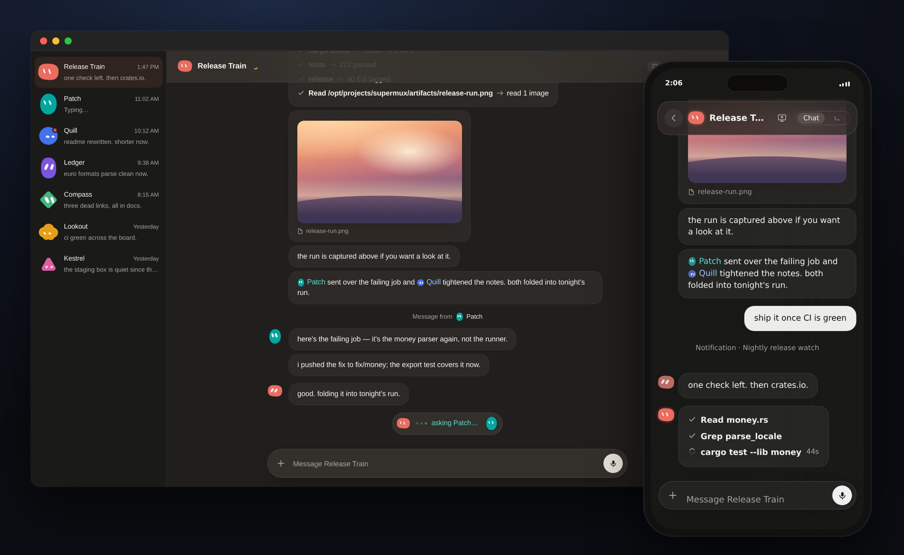
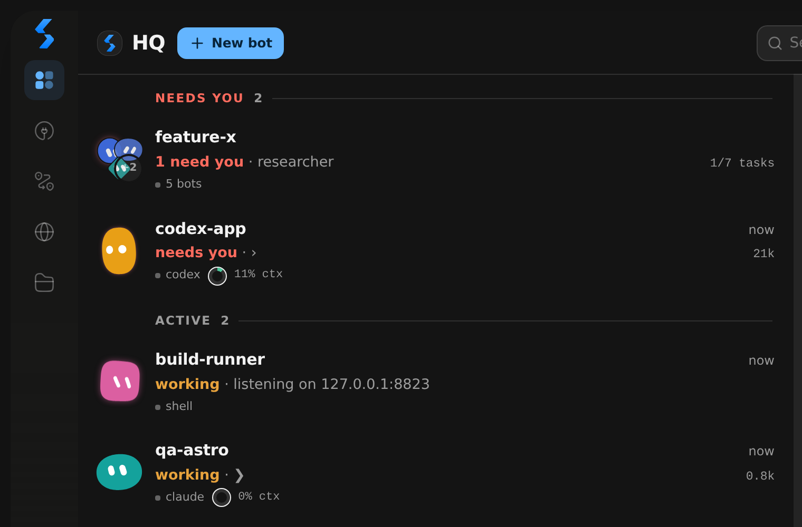
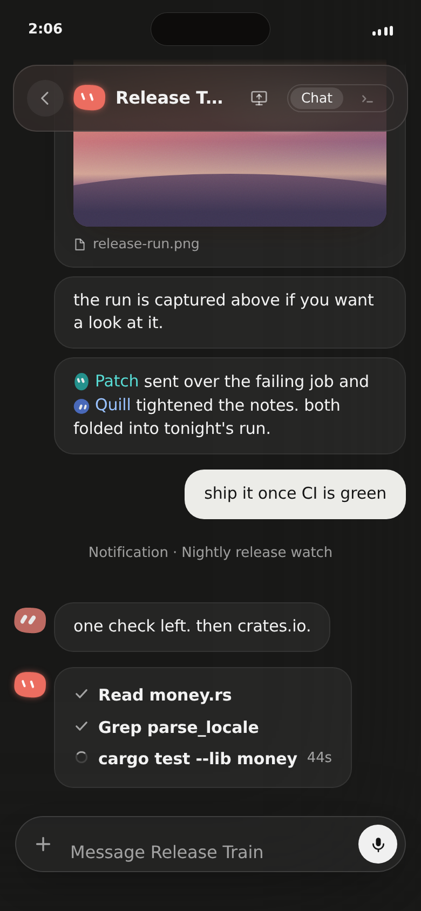
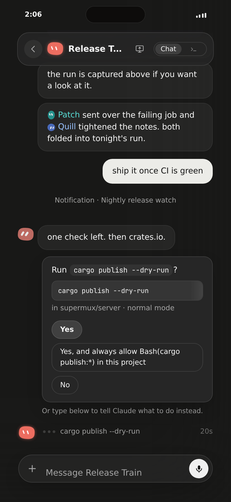
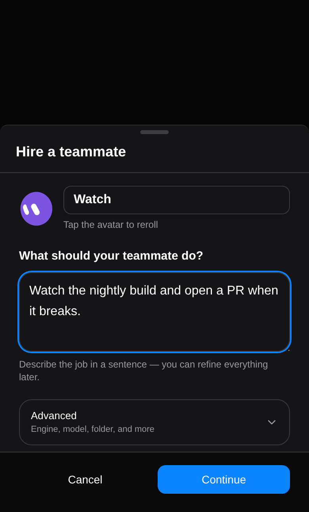
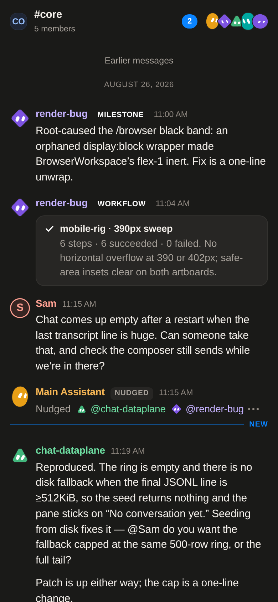
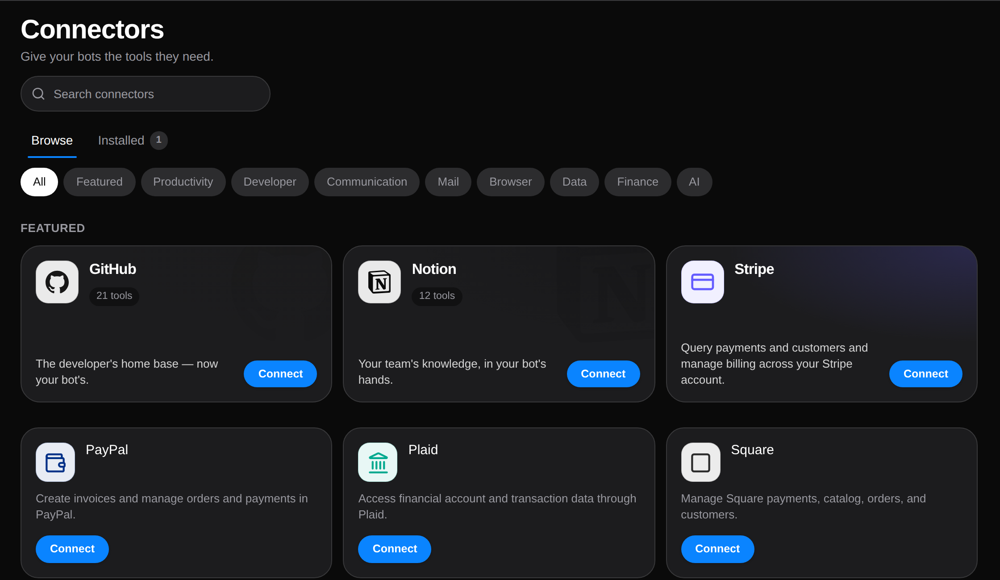
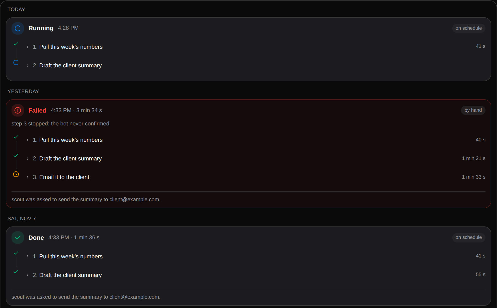
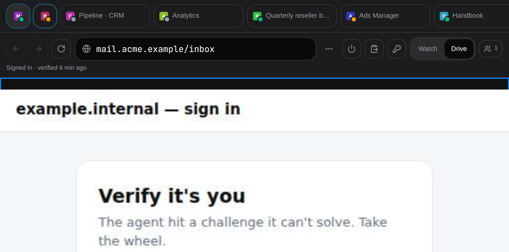
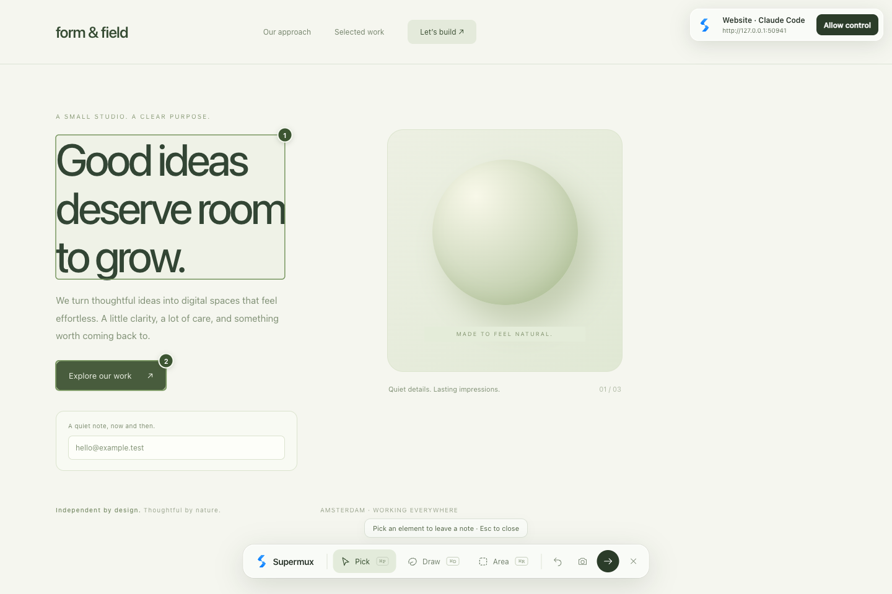

<h1 align="center">supermux</h1>

<p align="center">Run Claude Code and Codex agents on your own server, and work with them from your browser or your phone.</p>

<p align="center">
  
</p>

<p align="center">
  <a href="https://github.com/sanderbz/supermux/releases/latest"></a>
  <a href="LICENSE"></a>
</p>

<p align="center"><a href="#install">Install</a> · <a href="#a-look-around">Screenshots</a> · <a href="#how-it-compares">How it compares</a> · <a href="https://github.com/sanderbz/supermux/releases">Releases</a></p>

supermux is a web app you install on a machine you own, such as a VPS, a Raspberry Pi or a Mac mini. It starts Claude Code and Codex sessions on that machine and keeps them running when you close your laptop. You follow and answer every session from one dashboard, in a desktop browser or as an app on your phone with push notifications.

With Bot mode switched on, sessions become bots: each has a name, a role, its own folder and only the tools you grant it. You can group bots into a company that shares a chat, a set of connectors and a Chrome browser.

What makes it different:

- Everything runs on your hardware. supermux is one MIT-licensed Rust binary with the web app built in. Your browser connects straight to your server (over Tailscale if you use it), with no vendor service in between, and the agents use your own Claude or ChatGPT login.
- Bots work in companies. A company has a group chat where you ask once and a router passes the question to the right bots. Bots can also message each other and hand work over. Credentials sit in a vault on your server, connectors are granted per bot, and on Linux each company runs in a Landlock sandbox.
- A company shares a real Chrome on your server. You sign in to a site once, lend tabs to bots, and take over yourself when a bot gets stuck at a login or a captcha.
- It drives the real Claude Code and Codex command-line tools. The chat view shows each tool call as it happens, and you answer Claude's permission prompts and questions from chat. The full terminal stays one tap away.

## Install

On a server with Ubuntu 22.04+ or Debian 12+ (x86_64 or arm64):

```bash
curl -fsSL https://raw.githubusercontent.com/sanderbz/supermux/main/install.sh | sudo SUPERMUX_INSTALL_CLAUDE=1 bash
```

The installer downloads the release binary for your CPU and checks its checksum. It then creates an unprivileged `supermux` user, installs Claude Code for that user, and starts supermux as a sandboxed systemd service. If Tailscale is running, it serves supermux over HTTPS on your tailnet; otherwise supermux listens on `127.0.0.1:8824` for your own reverse proxy. At the end it prints the address and the command that shows your auth token. Run the same line again to upgrade; sessions and data are kept.

Then:

1. Log Claude Code in once for the service user: `sudo -u supermux -i claude`, then `/login`. supermux uses your Claude subscription, not an API key.
2. Open the address on your computer and on your phone. On the phone, add it to your home screen so push notifications work (on iOS this is required).
3. Start a session, or switch on Bot mode under Settings → Experimental and hire your first bot.

To read the script first, pin a version or do a dry run, see [install options](#install-options).

## A look around

<p align="center">
  
</p>
<p align="center"><sub>The overview sorts every session by who needs you first.</sub></p>

<p align="center">
  
  &nbsp;&nbsp;
  
</p>
<p align="center"><sub>Left: tool calls as they run. Right: answering Claude's permission prompt from chat.</sub></p>

A push notification arrives when a session finishes, asks a question or stops, and tapping it opens that thread. Permission prompts, questions (including multi-select) and Claude's own "always allow" options are answered from chat through Claude Code's hooks; a message typed under a permission prompt is sent as "no, do this instead". The same records are available over HTTP as the [asks API](docs/ASKS.md).

### Bot mode

<p align="center">
  
  &nbsp;&nbsp;
  
</p>
<p align="center"><sub>Left: hiring a bot starts with one sentence about its job. Right: the company chat, where the router passes your question on.</sub></p>

Connectors come from a store: curated cards plus a slice of the public [PulseMCP](https://www.pulsemcp.com/) catalog. You grant each one to a single bot or to a whole company, and remote connectors sign in through OAuth. When a bot needs a key for a service, it asks with a Connect card in chat and the secret goes straight to the vault on your server.

<p align="center">
  
</p>

A workflow is a list of prompts a bot runs in order: by hand, once, or on a schedule such as `every weekday at 9am`. When it finishes it can notify you, message another bot, post in the group chat or send through a connector.

<p align="center">
  
</p>

The shared browser is a Chromium on your server that the company's bots use. Watch shows what a bot is doing; Drive lets you take over, sign in or solve a check, and hand the tab back.

<p align="center">
  
</p>

### Chrome extension

The Point & tell extension sends feedback on any website to an agent. You click an element, draw around a detail or select an area, add a note, and the agent receives a screenshot, crops and the page's DOM context. You can also let the agent read, click and type in that tab until you press Stop. Download the extension and pair it from an agent's settings under Feedback Chrome Extension. Each website can be paired with a different agent. More in [setup and privacy](docs/BROWSER_FEEDBACK.md).

<p align="center">
  
</p>

## How it compares

As of November 2026:

- Anthropic's [Remote Control](https://code.claude.com/docs/en/remote-control) serves Claude Code sessions from a machine you own to the Claude app, with push notifications. If you only want to reach Claude Code from your phone, it is the simplest option. Traffic goes through claude.ai, and it runs Claude Code only.
- [Happy](https://github.com/slopus/happy) (MIT) and [amux](https://amux.io/) also run agents on your own hardware and come with phone apps. Happy syncs through an encrypted relay by default; amux is source-available (MIT with the Commons Clause).
- xAI's [Grok Bot](https://x.ai/bot) is closest to Bot mode: always-on bots that share a computer, connectors and a browser. It runs in xAI's cloud and is closed source.

supermux fits if you want all of it on your own server under an open-source license, Claude Code and Codex side by side, and bots organised into companies with their own chat, connectors and browser.

<details>
<summary><strong>All features</strong></summary>

### Sessions

- Live overview with status per session, sorted by who needs you, with custom groups and six sort modes.
- Chat view and full terminal for every session. The terminal has keys for Claude Code (permission mode, rewind, Esc, Ctrl-C) and an editor that lifts the prompt into a native text field, which is handy on a phone.
- Claude Code and Codex side by side. Codex installs and logs in on its first start.
- Resume any earlier conversation in a folder, and search the prompt history.
- Uploads by drag and drop or from the phone's file picker (up to 10 GB, resumable); the path lands at Claude's prompt.
- ⌘K command palette for sessions, slash commands, MCP tools and skills; ⌘1 to ⌘9 to jump between sessions.
- Agent teams show up as one card. Issues per session that agents can read, comment on and close.
- Sessions on other machines over SSH (Settings → Hosts).
- Files browser with an editor, and per-session git status.

### Bot mode

- Bots with a name, avatar, role and folder; companies with a group chat, a shared drive and shared connectors.
- Bots can message each other within a company, notify you, report on their issue and schedule their own follow-ups.
- Connector store with per-bot grants, a credential vault, OAuth sign-in for remote connectors and a health check.
- Workflows with schedules and completion actions.
- Shared Chrome per company with Watch and Drive, and an option to keep sites signed in.
- Invite colleagues through an in-app wizard: your own domain on Cloudflare with Google sign-in, or a temporary link.
- A separate Claude account per session if you need one.

### Running it

- Push notifications per event type, with a test button in Settings → Notifications.
- In-app updates with automatic rollback when supermux runs from a source checkout; installs from the one-liner upgrade by running it again.
- Sessions survive a restart or upgrade of supermux.

</details>

## Self-hosting

- One binary with the web app embedded, plus a SQLite database. At runtime the core needs `tmux` and Claude Code (or Codex). Some Bot mode features need more: `python3` for the `connect` helper and the mail connectors, `npx` or `uvx` for store connectors, a Chromium build for the shared browser, and `cloudflared` for temporary invite links. The installer does not install these.
- The systemd unit runs as an unprivileged user with `ProtectSystem=strict`, `PrivateTmp`, a system-call filter, restricted address families and write access limited to the data directory, the service user's home and your project folders.
- The dashboard API requires the owner token (`~/.supermux/auth_token`, mode 0600) or an invited person's login. The app page hands the token to browsers on trusted addresses such as localhost and your tailnet, so keep the port off the public internet.
- The installer and updater support Linux (Ubuntu 22.04+, Debian 12+, x86_64 and aarch64). macOS, including a Mac mini, works with a manual build from source. Windows is not supported; WSL2 works as a Linux host.

## Limits

- Bot mode is off by default. Switch it on under Settings → Experimental; everything else works without it.
- Company isolation is best effort. It combines app-level scoping, the systemd sandbox and Landlock where the kernel supports it. Don't put companies that must not see each other on one server.
- Answering from chat works for Claude Code sessions. MCP forms are answered in the terminal unless you switch that on, and sessions started before an upgrade fall back to the older cards until they restart.
- Bot mode runs Claude Code. It can do what you could do at a keyboard and makes the mistakes an agent makes. Keep a person in the loop for anything that matters.

<a id="install-options"></a>
<details>
<summary><strong>Install options</strong></summary>

Read the script before running it:

```bash
curl -fsSL https://raw.githubusercontent.com/sanderbz/supermux/main/install.sh -o install.sh
less install.sh
sudo bash install.sh
```

When you run it from a file like this, the installer asks whether to install Claude Code.

- Pin a version: `--version vX.Y.Z` or `SUPERMUX_VERSION=vX.Y.Z`.
- Print the plan and change nothing: `--dry-run`.
- Install without starting the service: `--no-start`.
- Other settings: `SUPERMUX_INTERNAL_PORT` (default 8824), `SUPERMUX_PROJECT_DIRS` (folders agents may write to, default `~/projects` of the service user), `SUPERMUX_USE_TAILSCALE=0|1`, `SUPERMUX_INSTALL_CLAUDE=ask|1|0`.

With Tailscale, rename the machine once (`sudo tailscale set --hostname=supermux`) to get an HTTPS address such as `https://supermux.<tailnet>.ts.net` on every device in your tailnet.

Other ways to run it:

- From a clone, `sudo bash install.sh` still installs the latest release binary. For a source build use `scripts/dev.sh` (local development, backend on `:8823` plus Vite) or [`scripts/deploy.sh`](scripts/deploy.sh) (build and deploy to a server over SSH).
- Building from source needs Rust 1.87+, a recent `bun` 1.x and `build-essential pkg-config libssl-dev cmake unzip`. See [`docs/TESTING.md`](docs/TESTING.md).

</details>

<details>
<summary><strong>Deploy guide (scripts/deploy.sh)</strong></summary>

`scripts/deploy.sh` runs on your workstation. It sends a pinned `git archive` of a clean commit over SSH to a remote host, builds it there, installs `/usr/local/bin/supermux-server` with the systemd unit and starts the service. It checks the host first and prints a plan before changing anything.

- The service runs as an unprivileged user, even when you deploy as root. Running it as root needs `SUPERMUX_ALLOW_ROOT=1`, because root disables the sandbox and Claude Code refuses `--dangerously-skip-permissions` as uid 0.
- `SUPERMUX_SERVICE_USER` (default `supermux`) is created if missing.
- `SUPERMUX_REPO_DIR` points the in-app updater at the source clone (default `/opt/projects/supermux`).
- `SUPERMUX_PROJECT_DIRS` (default `<user-home>/projects`): folders outside the home directory are created, given to the service user and added to the unit's `ReadWritePaths`.
- `SUPERMUX_INSTALL_CLAUDE` (`ask`, `1` or `0`) installs Claude Code for the service user. The script also offers to copy your existing Claude login.
- `SUPERMUX_INSTALL_TOOLCHAINS=1` installs `bun` and `rustup` if they are missing.
- Agents can read Git SSH keys and other secrets from 1Password through a read-only service account: [`docs/SECRETS_1PASSWORD.md`](docs/SECRETS_1PASSWORD.md).

### TLS

supermux listens on `127.0.0.1` over plain HTTP. Put TLS in front with a reverse proxy (nginx, Caddy) to `http://localhost:8824`, or with `tailscale serve` (`SUPERMUX_USE_TAILSCALE=1`).

### WebSocket origins

WebSocket upgrades from an unknown `Origin` are closed with code 1008. Localhost, private LAN ranges, `*.ts.net` and the bind address are allowed. Add other hostnames in `~/.supermux/config.toml` and restart:

```toml
bind = "127.0.0.1:8824"
extra_origins = ["supermux.corp.example", "box-12.internal.example"]
```

### Company isolation

Company bots run in an OS sandbox (Landlock on Linux, Seatbelt on macOS) that allows the company folder, `~/.claude`, `~/.codex`, `/tmp` and the toolchains. `isolation_mode` in `config.toml` is `best-effort` (default; warns and continues where the kernel can't enforce it), `strict-required` (refuses to start a company bot without the sandbox) or `off`.

A company that needs more access gets it per company:

```toml
# ~/.supermux/config.toml
[[company_isolation]]
company = "ops"                           # the company's folder name under companies/
read_only = ["~/.ssh", "~/.config/gh"]    # read and execute
read_write = []
```

Paths are refused (with a logged reason) when they are relative, contain `..`, don't exist, go through a symlink, are `/` or the home directory, touch the supermux data directory, or point into another company. The file is read at startup: restart the service, then restart the company's bots.

### Verify

```bash
curl -sf http://127.0.0.1:8824/api/health
journalctl -u supermux -n 50
```

</details>

<details>
<summary><strong>Push notifications</strong></summary>

Push works out of the box with a placeholder VAPID contact. To use your own, set `push_sub = "mailto:you@your-domain"` in `~/.supermux/config.toml` or export `SUPERMUX_PUSH_SUB`. Settings → Notifications has a Send test button.

On iOS, Safari only allows push for web apps added to the home screen: add supermux to the home screen first, then allow notifications inside the installed app.

</details>

<details>
<summary><strong>Architecture</strong></summary>

- Backend: Rust (`axum`, `tokio`, `sqlx` with SQLite) in `server/`.
- Frontend: TypeScript, React and a Vite PWA in `web/`, embedded in the binary.
- Sessions: local sessions run in a built-in pty holder that survives restarts; remote hosts and agent teams use tmux.
- Live data: WebSockets for terminal streams, server-sent events for everything else.

More in [`ARCHITECTURE.md`](ARCHITECTURE.md).

</details>

## Contributing

Issues and pull requests are welcome. [`CONTRIBUTING.md`](CONTRIBUTING.md) has the development setup; report security issues privately through [`SECURITY.md`](SECURITY.md). CI runs the Rust tests (unit tests plus integration tests in `server/tests/`), a TypeScript build and Playwright smoke tests.

## License

MIT, see [`LICENSE`](LICENSE). Third-party licenses are listed in [`THIRD_PARTY_NOTICES.md`](THIRD_PARTY_NOTICES.md).
